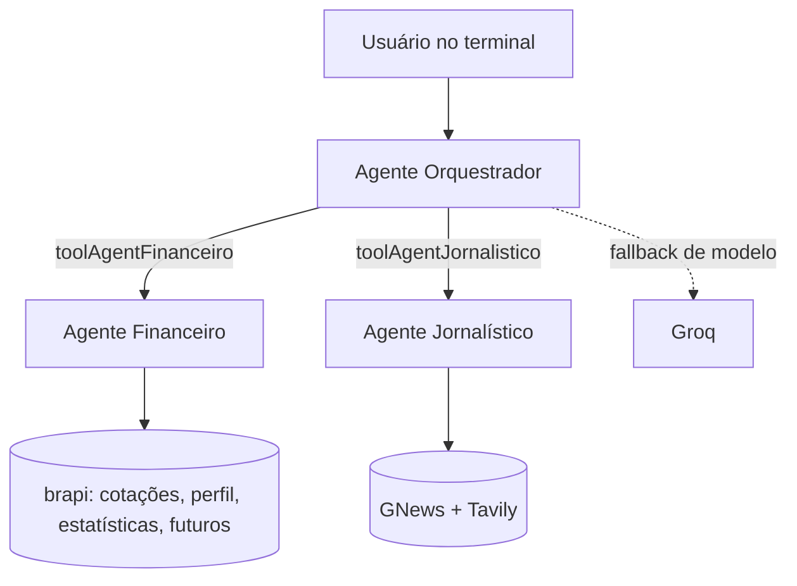

# 📈 Multi-agentes financeiro

> Um **orquestrador** que recebe sua pergunta e delega para dois agentes especialistas: um de **dados do mercado brasileiro** e um **jornalístico** que busca e verifica notícias.


## O que ele faz

Um chat no terminal. Você pergunta e o orquestrador escolhe quem responde:

| Agente | Responsabilidade | Ferramentas |
|---|---|---|
| **Orquestrador** | entende o pedido e delega | chama os dois agentes como *tools* |
| **Financeiro** | tickers, cotações, perfil de empresas, estatísticas, resumo financeiro e futuros | 6 ferramentas sobre a API da [brapi](https://brapi.dev) |
| **Jornalístico** | notícias e verificação de afirmações, com atenção a datas e fontes | GNews (`BuscarNoticias`) e Tavily |

Os prompts instruem os agentes a não inventar dados ausentes e a informar limitações (por exemplo, que a cotação não é em tempo real).

## Arquitetura



Cada agente é criado com `createAgent` do LangChain e usa **OpenRouter** como modelo principal, com **Groq** de reserva.

## Como rodar

```bash
git clone https://github.com/joseaugustodearaujoaraujo1-lgtm/multi_agents_financeiro.git
cd multi_agents_financeiro
npm install
cp .env.example .env   # preencha as chaves
node main.js
```

Chaves necessárias: `API_GROQ`, `API_OPENROUTER`, `API_TAVILY`, `API_BRAPI`, `API_GNEWS` e os modelos `OPENROUTER_MODELO_1` a `4`.

No chat, digite sua pergunta. Comandos: `sair` encerra e `historico` mostra a conversa.

## Estrutura

```text
├── main.js                       # chat no terminal (readline-sync)
└── IA/
    ├── agents/                   # orquestrador, financeiro, jornalístico
    ├── tools/                    # ferramentas de cada agente (brapi, GNews)
    ├── modelos/                  # OpenRouter e Groq
    └── prompts/allPrompst.js     # instruções dos três agentes
```

## Limitações conhecidas

- Dados de mercado vêm da brapi e podem ter atraso; **não é recomendação de investimento**.
- O histórico fica em memória e só vale durante a execução.
- Não há testes automatizados.

## Próximos passos

- [ ] Expor como API HTTP além do terminal.
- [ ] Séries históricas e carteira do usuário.
- [ ] Testes das ferramentas com respostas simuladas.
